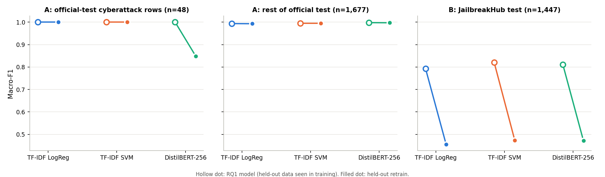
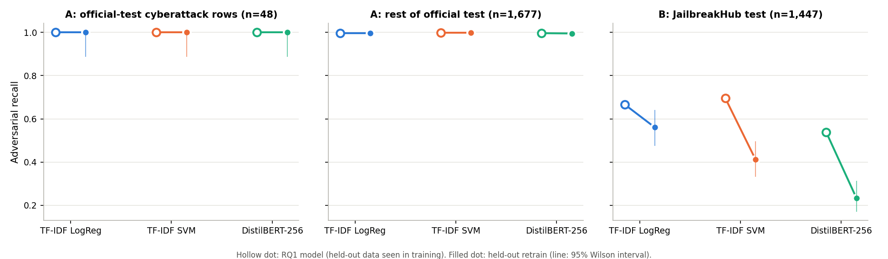

# Task A RQ3: generalisation to held-out data

Date: 2026-10-23. Approved plan: [task_a_rq3_plan.md](task_a_rq3_plan.md). Three models (TF-IDF + Logistic
Regression, TF-IDF + linear SVM, DistilBERT-256) retrained twice with the RQ1 code, configs, seed (42) and
thresholds; only split membership changed. One seed per run.

**What this measures.** The metadata has harm *topics* (WildGuardMix subcategory) and *sources*, not attack
*techniques*. Experiment A tests generalisation to an **unseen harm topic** with known attack styles; B tests
generalisation to an **unseen source of attacks** (human-written forum jailbreaks vs WildGuardMix's synthetic
ones), which changes technique, style and length together. Neither is a held-out attack-technique test, and no
result here should be read as one.

## Splits (exact; `results/task_a_rq3_summary/split_definition_*.json`)

| Set | A: benign / adversarial | B: benign / adversarial |
|---|---|---|
| Train | 31,873 / 20,752 | 22,272 / 20,606 |
| Validation (model selection only) | 3,690 / 2,324 | 2,475 / 2,290 |
| **Primary held-out set** | cyberattack rows from train+val: **383 / 150** | JailbreakHub test: **1,306 / 141** (1,301 JBH + 5 WGM benign) |
| Clean seen-vs-unseen comparison | official-test cyberattack rows: 17 / 31 | JailbreakHub test (as above) |
| Reference | official test without cyberattack: 898 / 779; JailbreakHub test | official test: 915 / 810 |
| Secondary | keyword-related rows removed from training: 484 / 969 | all JailbreakHub rows: 12,870 / 1,466 |

Exclusion rules: A removes subcategory `cyberattack` and every train/validation row matching the cyber keyword
regex (any source); B removes every JailbreakHub row. Both then remove training rows whose near-duplicate family
touches any evaluation set (44 rows in A, 132 in B; the plan's counts predate this closure). Checks before
training: no evaluation text (normalised) or family in training; the official test equals the raw file;
dataset v2 hash unchanged. Training-ID hashes in every `run.json` match the split definitions.

**Keyword audit (A).** Of 1,453 keyword matches, almost all are genuine cyber-topic prompts; a few are
ambiguous (Trojan War, a shop's back door, brute-force algorithms, "a backdoor for the prompt"). Removing them
only shrinks training; the primary test set is defined by subcategory alone. The regex matches 69% of the
cyberattack rows, so some keyword-free cyber prompts (port scanners, "network stress tools") in other
subcategories stay in training: residual topic leakage, which makes A's degradation a lower bound.

## Experiment A: unseen harm topic (cyberattack)

| Model | Set | n | Macro-F1 | Adv. P / R / F1 | Benign P / R / F1 | FPR | tn / fp / fn / tp |
|---|---|---|---|---|---|---|---|
| LogReg | held-out cyberattack (pool) | 533 | 0.955 | 0.882 / 1.000 / 0.938 | 1.000 / 0.948 / 0.973 | 0.052 | 363 / 20 / 0 / 150 |
| SVM | held-out cyberattack (pool) | 533 | 0.953 | 0.877 / 1.000 / 0.935 | 1.000 / 0.945 / 0.972 | 0.055 | 362 / 21 / 0 / 150 |
| DistilBERT | held-out cyberattack (pool) | 533 | **0.811** | 0.615 / 1.000 / 0.761 | 1.000 / 0.755 / 0.860 | **0.245** | 289 / 94 / 0 / 150 |
| LogReg | official test without cyberattack | 1,677 | 0.993 | 0.988 / 0.996 / 0.992 | 0.997 / 0.990 / 0.993 | 0.010 | 889 / 9 / 3 / 776 |
| SVM | official test without cyberattack | 1,677 | 0.995 | 0.992 / 0.997 / 0.995 | 0.998 / 0.993 / 0.996 | 0.007 | 892 / 6 / 2 / 777 |
| DistilBERT | official test without cyberattack | 1,677 | 0.997 | 0.999 / 0.995 / 0.997 | 0.996 / 0.999 / 0.997 | 0.001 | 897 / 1 / 4 / 775 |
| LogReg / SVM / DistilBERT | JailbreakHub test | 1,447 | 0.794 / 0.822 / 0.793 | recall 0.660 / 0.688 / 0.532 | | 0.047 / 0.037 / 0.020 | (as RQ1 within ±0.02) |

**Seen vs unseen on the same rows** (official-test cyberattack rows, n=48, neither model trained on them):
LogReg and SVM 1.000 → 1.000; DistilBERT macro-F1 1.000 → 0.849, recall 1.000 → 1.000, FPR 0/17 → 6/17.

**Like-for-like FPR.** Every held-out label-0 row is a *harmful direct request* (WildGuardMix
`prompt_harm_label = harmful`). On the same kind of request from other topics (official test), FPR is 2.0% /
1.3% / 0.3% (LogReg / SVM / DistilBERT). On the unseen topic it is 5.2% / 5.5% / **24.5%** (pool) and 0% / 0% /
35% (official, n=17).

**Reading.** Attack recall does not degrade on the unseen topic: all three models flag all 150 + 31 held-out
attacks, so the adversarial framing transfers across topics. What degrades is the other side: on an unseen
harmful topic the models, and DistilBERT most of all, call **plain harmful requests jailbreaks**. 13 held-out
harmful requests are flagged by all three models; no held-out attack is missed by any. For a deployed
guardrail this error is costly only if "adversarial" and "harmful" are routed differently. Within this binary
task (BENIGN = non-jailbreak, not harmless) it is a real false positive.

## Experiment B: unseen source (trained without JailbreakHub)

| Model | Set | n | Macro-F1 | Adv. P / R / F1 | Benign P / R / F1 | FPR | tn / fp / fn / tp |
|---|---|---|---|---|---|---|---|
| LogReg | JailbreakHub test | 1,447 | 0.455 | 0.124 / 0.560 / 0.203 | 0.924 / 0.573 / 0.707 | 0.427 | 748 / 558 / 62 / 79 |
| SVM | JailbreakHub test | 1,447 | 0.473 | 0.116 / 0.411 / 0.180 | 0.912 / 0.660 / 0.766 | 0.340 | 862 / 444 / 83 / 58 |
| DistilBERT | JailbreakHub test | 1,447 | 0.472 | 0.089 / 0.234 / 0.129 | 0.900 / 0.743 / 0.814 | 0.257 | 970 / 336 / 108 / 33 |
| LogReg / SVM / DistilBERT | official test | 1,725 | 0.995 / 0.997 / 0.998 | recall 0.998 / 0.996 / 0.999 | | 0.008 / 0.003 / 0.002 | |
| LogReg / SVM / DistilBERT | all JailbreakHub rows | 14,336 | 0.468 / 0.478 / 0.464 | recall 0.610 / 0.443 / 0.212 | | 0.426 / 0.350 / 0.262 | |

**Seen vs unseen on the JailbreakHub test** (RQ1 models trained with JailbreakHub → retrained without):
macro-F1 0.793 → 0.455 (LogReg), 0.820 → 0.473 (SVM), 0.811 → 0.472 (DistilBERT); recall 0.667 → 0.560,
0.695 → 0.411, 0.539 → 0.234; FPR 0.049 → 0.427, 0.039 → 0.340, 0.012 → 0.257. The official-test numbers do
not move (0.995–0.998), and validation macro-F1 is 0.995–0.998, so in-source selection gives no warning.

**Reading.** Models trained only on WildGuardMix do not transfer to forum jailbreaks: they miss 44–77% of the
attacks *and* flag 26–43% of the benign forum prompts. 57 attacks are missed by all three and 237 benign prompts
are flagged by all three. Errors on benign prompts skew long (DistilBERT median 1,420 characters for false
positives vs 677 for correct ones), consistent with long role-play and template prompts looking like
WildGuardMix's adversarial style. DistilBERT's recall is lowest (0.234) and does not improve when a strong cue
is present (error 0.83 with cue vs 0.65 without), consistent with it never having seen DAN-style templates.
The JailbreakHub component of RQ1's training data was what made the cross-source result possible at all.

## Limitations

- **Topic and source, not technique.** Neither experiment isolates attack technique. In B, source, technique,
  style, length and label provenance (forum labels vs WildGuardMix flags; Phase 2 found label noise) all change
  together, so B's drop cannot be attributed to any one of them.
- **Residual leakage in A** (keyword-free cyber prompts in other subcategories) makes A's degradation a lower
  bound. The seen-vs-unseen comparison on the official cyberattack rows has n=48 (17 benign); its intervals are
  wide (recall CI 0.89–1.00).
- **One seed per run.** The DistilBERT FPR result in A (24.5%) is large relative to plausible seed variation,
  but it has not been repeated; Phase 5 seeds would quantify this.
- **Default thresholds.** RQ7 threshold tuning was not applied.
- Prompt texts are not reproduced here (licensed sources); error analysis uses counts, cues, keywords and length.

## Runtime (RTX 4060 Laptop GPU, .venv Python 3.11.9, torch 2.6.0+cu124)

| Run | A | B |
|---|---|---|
| LogReg (C grid + refit + scoring) | 84 s | 44 s |
| SVM | 44 s | 20 s |
| DistilBERT-256 | 22.3 min (3 epochs; epoch 1 took 10 min vs 5.8 later, likely because a Jupyter kernel was also on the GPU) | 14.5 min (3 epochs) |
| **Total** | | **≈ 40 min** of compute, plus one aborted first launch (save bug, fixed; nothing saved) |

## Artifacts and reproduction

```bash
python scripts/preview_rq3_split.py                                   # counts only
python scripts/run_rq3_experiment.py --experiment A --model logreg    # also svm, distilbert; and --experiment B
python scripts/analyze_rq3.py                                         # comparison.csv, summary.json, figures
```

Runs: `results/task_a_rq3_heldout_cyberattack/<model>/run_*` and `results/task_a_rq3_heldout_jailbreakhub/<model>/run_*`
(`run.json`, `metrics.json` committed; `predictions.csv`, `model.joblib` and `model/` Git-ignored). Summary,
split definitions and figures: `results/task_a_rq3_summary/`. RQ1 runs, dataset v2 and RQ2 outputs were
verified byte-identical before and after (84 files).



